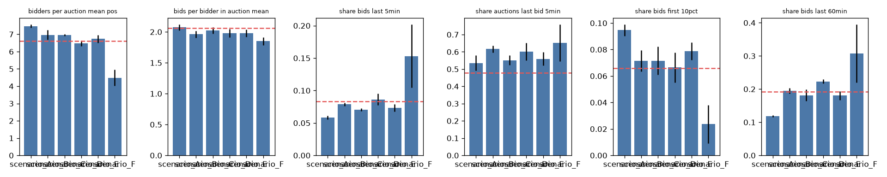
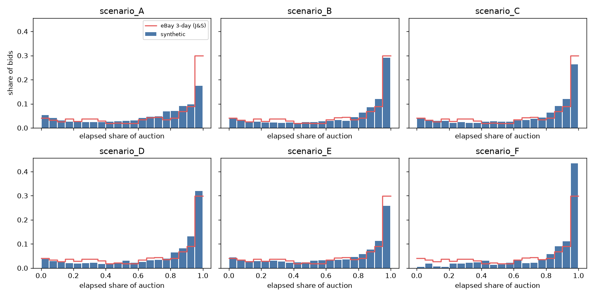

# 합성 데이터 검증 보고서

**대상과 실행 방법**
- 대상 데이터: `data/synthetic/scenario_{A..F}/seed_{1,2,3}` 18개.
- 검증: `python validation/validate.py --repro all`
- 메커니즘 점검: `python validation/mechanism_check.py`
- 수치 원본: `validation/results.json`, `validation/mechanism_check.json`. 그림은 `validation/figures/`에 있다.

아래 수치는 모두 이 스크립트들을 실행해서 나온 값이다. 소규모 테스트(`data/smoke`: 시나리오당 구매자 200명, 경매 60개, F는 원 규모)로 구조 검증을 먼저 통과시킨 뒤 전체를 생성했다. 이 보고서는 보정 4차 이후의 최종 데이터 기준이다.

## 1. 요약

| 항목 | 결과 |
|---|---|
| 구조 검증 | 18/18 통과 |
| 재현성 (같은 시드 → 같은 CSV, SHA-256) | 18/18 동일 |
| 종료 시각 변경 후 재시뮬레이션 | 작동한다. 세계·가치·방문 후보는 그대로 두고 결과만 다시 계산한다 |
| eBay·Goodwill 보정 목표 9개 | 7개 일치. 재입찰 쌍 비율은 낮고, 막판 입찰 경매 비율은 높다 |
| 30% 홀드아웃 비교 | 쌍당 입찰 수, 입찰 수 분산, 가격–입찰 관계 모두 범위 안 |
| 보정하지 않은 항목 | 입찰 시각 분포의 형태는 일치한다. 낙찰가 분산과 조회–입찰 탄력도는 실데이터보다 크다 |
| 시나리오 메커니즘 | 종료 시간대 효과는 크다. 동시 집중 효과는 D에서만 양수다 |

## 2. 구조 검증

각 데이터셋에서 모든 입찰과 마감을 시간순으로 다시 재생했다. 가격은 프록시 규칙으로, 예산은 구매자별로 추적했다.

| 검사 | 결과 (18개 전부) |
|---|---|
| 입찰 시각이 [시작, 예정 종료] 안에 있다 (하드클로즈, 1초 허용) | 통과 |
| 실제 종료 = 예정 종료, 경매 기간 24–72시간 | 통과 |
| 최소 증가분: 선두가 아닌 입찰자의 제출액 ≥ 현재가 + 증가분 (첫 입찰은 시작가 이상) | 위반 0 |
| 재생한 가격 경로 = `price_after`, 재생한 선두 = `leader_after_is_bidder` | 불일치 0 |
| 낙찰자·낙찰가 = 재생 결과 | 통과 |
| 입찰 없는 경매: 낙찰자 없음, sold=False | 통과 (시나리오별 11–13%) |
| 입찰 시점 예산: 제출액 ≤ 예산 − 지출 − 다른 경매에서 선두로 묶인 금액 | 위반 0 |
| 기간 전체 지출 ≤ 예산 | 통과 |
| ID 고유성, 참조 무결성, outcomes 1:1, 경매별 입찰 수 일치 | 통과 |
| 같은 설정·시드로 재생성 → CSV 바이트 동일 | 18/18 |

개발 중에 구조 결함을 하나 찾아 고쳤다.
- 증상: 같은 순간에 한 구매자가 낸 여러 입찰이 출력 단계에서 경매 ID 순으로 다시 정렬됐다. 그 결과 재생 때 예산 검사가 2건 실패했다.
- 성격: 시뮬레이터가 아니라 출력 정렬의 결함이었다.
- 수정: 출력할 때 사건 순서를 유지하도록 했다.

## 3. 실데이터와의 통계 비교

**표를 읽는 법**
- 실데이터 값은 Jank & Shmueli 3일 경매 평균이다(LAYER7의 24–72시간에 가장 가깝다). 쌍 단위 지표와 분산은 보정 분할(70%) 전체 기준이다.
- 괄호 안은 보정에 쓰지 않은 30% 홀드아웃 값이다.
- 합성 값은 시나리오별 시드 3개의 평균이다.
- "보정"은 `calibration/tune.py`가 맞추려 한 목표라는 뜻이다. 이 항목이 맞는 것은 독립적인 검증이 아니다. 홀드아웃 열이 그나마 독립적인 비교다(같은 시장의 다른 경매).

| 지표 | 실데이터 (홀드아웃) | A | B | C | D | E | F | 보정 | 판정 |
|---|---|---:|---:|---:|---:|---:|---:|---|---|
| 경매당 고유 입찰자 (입찰 ≥1) | 6.60 (8.35, 전 기간) | 7.47 | 6.97 | 6.97 | 6.48 | 6.74 | 4.49 | 보정 | 일치 (F 제외) |
| 입찰자–경매 쌍당 입찰 | 2.06 (2.06) | 2.07 | 1.96 | 2.03 | 1.98 | 1.98 | 1.85 | 보정 | 일치 |
| 2회 이상 입찰한 쌍 비율 | 0.44 (0.42) | 0.31 | 0.31 | 0.33 | 0.31 | 0.31 | 0.28 | 보정 | **낮음** (−25~−30%) |
| 경매당 입찰 수 분산 (NB size, 작을수록 분산 큼) | 2.06 (2.79) | 2.28 | 2.31 | 2.15 | 2.04 | 2.22 | 2.15 | 보정 | 일치 |
| log 낙찰가 ~ log 입찰 수 기울기 (낙찰만, 카테고리 고정효과) | Goodwill 0.755 (0.770) | 0.81 | 0.82 | 0.79 | 0.83 | 0.73 | 0.55 | 보정 | 일치 (F 낮음) |
| 마지막 5분 입찰 비율 | 0.083 (0.060) | 0.058 | 0.079 | 0.071 | 0.086 | 0.073 | 0.153 | 보정 | 일치 (A 낮음, F 높음) |
| 마지막 60분 입찰 비율 | 0.192 (0.147) | 0.119 | 0.195 | 0.182 | 0.223 | 0.180 | 0.307 | 보정 | 일치 (A 낮음, F 높음) |
| 처음 10% 시간 입찰 비율 | 0.066 (0.088) | 0.095 | 0.071 | 0.072 | 0.066 | 0.079 | 0.024 | 보정 | 일치 (A 높음, F 낮음) |
| 마지막 입찰이 종료 5분 안인 경매 | 0.48 (전 기간 0.47) | 0.54 | 0.62 | 0.55 | 0.60 | 0.56 | 0.65 | 보정 | **높음** (+12~+29%) |
| 입찰자별 입찰 수 Gini | J&S 0.48, Swoopo 0.75 | 0.61 | 0.60 | 0.60 | 0.60 | 0.60 | 0.57 | – | 일치 (두 값 사이) |
| log1p 입찰 ~ log1p 조회 기울기 | MaxSold 0.415 | 1.07 | 0.93 | 0.94 | 0.97 | 0.94 | 1.23 | – | **불일치** (다른 시장) |
| 낙찰가 log 표준편차 (B seed 1, 카테고리별) | Goodwill 단품 0.89, LEGO 0.85, eBay 레트로 1.37 | | 피규어 1.38, 한정판 1.31, 레트로 1.41, TCG 1.39 | | | | | – | **피규어·한정판 과대** |
| 입찰 없는 경매 비율 | MaxSold lot 0.067 | 0.116 | 0.120 | 0.110 | 0.129 | 0.128 | 0.133 | – | 비교 불가 (시장이 다름) |

### 보정 4차에서 바꾼 것

3차까지 맞지 않던 세 항목을 고치기 위해 모형을 세 군데 바꿨다.

1. **시작가 규칙: ASSUMED → EMPIRICAL.**
   - 이전: 상품 가치의 30–70% 균등분포(ASSUMED).
   - 변경: J&S 실제 경매의 "시작가 ÷ 낙찰가" 분위수 함수(21점, 보정 분할)에서 비율을 뽑아 상품 가치에 곱한다. 하한은 1,000원이다.
   - 실제 eBay 경매는 절반 이상이 낙찰가의 16% 미만에서 시작한다. 그래서 비싼 상품일수록 입찰 단계가 많아지고, 가격–입찰 관계가 생긴다.
   - 한계: 분모가 상품 가치가 아니라 낙찰가다. LAYER7의 시작가 정책은 알 수 없다.
2. **같은 세션 안의 재입찰.** 상회 당한 뒤 10분 안의 재입찰은 시간대 가용성 검사를 건너뛴다. 이 구매자는 아직 사이트에 있기 때문이다. 근거는 J&S에서 재입찰의 70%가 10분 안에 일어난다는 점이다.
3. **인기 상품의 지불 의사.**
   - 상품 매력도(appeal)가 열람 가중치뿐 아니라 WTP에도 곱해진다(`appeal_wtp_elasticity`, ASSUMED, 튜닝 결과 1.0).
   - 매력도 분산은 log 0.8에서 1.4로 커졌다(튜닝).
   - 이 변경으로 "인기 상품 = 입찰 많음 = 가격 높음"이 생겨 입찰 수 분산과 가격–입찰 기울기가 맞게 됐다.

**튜닝 4차 결과**
- loss 0.117. 목표 9개, 격자 64점, 시드 101.
- 기록: `calibration/statistical_analysis/results/tuning_log.txt`
- 이전 차수: `tuning_log_pass1~3.txt`

### 남은 불일치와 맞바꾼 것

1. **낙찰가 분산이 커졌다.**
   - 피규어와 한정판의 낙찰가 log 표준편차가 1.3–1.4다. Goodwill·LEGO는 0.85–0.89다.
   - 원인: 매력도→WTP 경로가 상품 가치 분산 위에 분산을 더 얹는다(매력도 log 1.4 × 탄력도 1).
   - 맞바꾼 것: 가격–입찰 기울기와 입찰 수 분산을 맞춘 대가다.
   - 대안: 둘 다 맞추려면 카테고리 기본 분산(`price_logsd_*`)을 낮추거나, 매력도 분산을 줄이고 다른 경로로 수요 차이를 만들어야 한다. 이번에는 하지 않았다.
2. **조회–입찰 탄력도가 MaxSold의 2배 이상이다.**
   - MaxSold는 lot 100여 개짜리 에스테이트 세일이다. 조회 대부분이 입찰 의사 없는 둘러보기라 시장 구조가 다르다.
   - 다만 매력도 분산을 키운 뒤 차이가 커졌다(0.5 → 0.9–1.1).
3. **재입찰 쌍 비율이 낮다(0.31 대 0.44).**
   - 쌍당 평균 입찰은 맞는다. 다만 한 번만 입찰하는 쌍이 많고, 여러 번 입찰하는 쌍의 횟수가 더 많은 분포가 됐다.
4. **마지막 입찰이 종료 5분 안인 경매가 많다(0.55–0.62 대 0.48).** 막판 입찰자 비율이 튜닝에서 0.3으로 올라간 결과다.
5. **판매율 86–90%(F 84–88%).** 미낙찰이 관측된 실데이터가 없어서 보정할 근거가 없다.

## 4. BARISTA와의 비교 (독립 검증, 보정 목표 아님)

- 방법: 시나리오별로 정규화한 입찰 시각 표본 12,000개(F는 약 1,200개)에 BARISTA를 적합했다.
- 비교 대상: J&S 3일 경매 통합 적합값을 [0,1]로 바꾼 것이다. α=(2.01, 0.34, 1.95), d1=0.46.

| 시나리오 | 우도비 선택 | α1 | α2 | α3 | d1 | 실데이터 CDF 대비 KS D |
|---|---|---:|---:|---:|---:|---:|
| A | BARISTA | 5.53 | 0.53 | 0.41 | 0.16 | 0.124 |
| B | BARISTA | 3.34 | 0.36 | 1.09 | 0.24 | 0.072 |
| C | BARISTA | 3.05 | 0.39 | 1.01 | 0.24 | 0.060 |
| D | BARISTA | 4.07 | 0.33 | 1.08 | 0.20 | 0.105 |
| E | BARISTA | 2.19 | 0.40 | 0.84 | 0.34 | 0.059 |
| F | NHPP2 | – | 0.22 | 0.99 | – | 0.203 |

판정: B–E는 부분 일치에서 일치 사이다.
- 일치하는 점: 3단계 구조가 선택되고, 중반부 α2≈0.33–0.40(실데이터 0.34)이며, 종료부 α3≈1(논문의 "마지막 몇 분은 균등")이다.
- 다른 점: 초반 단계가 조금 짧다(d1 0.20–0.34 대 0.46).
- A: 활동이 평탄해 종료부가 약하다(α3 0.41).
- F: 구매자가 적어 초반 단계가 없다.
- KS: 표본이 커서 모두 기각된다. 그래도 D 값 0.06–0.12는 J&S 데이터셋끼리 홀드아웃 KS를 했을 때의 범위(0.03–0.26)와 같다.

## 5. 시나리오 메커니즘 점검

같은 세계(설정·시드)에 종료 시각 배치 4개를 적용해 비교했다. 추천 정책을 평가하는 것이 아니다. 시뮬레이터의 가정이 서로 다른 방향의 효과를 낼 수 있는지 확인하는 것이다.

**배치 4개**
- concentrate: 모든 경매가 21:00 KST에 종료
- spread_evening: 같은 날 18–24시에 분산
- spread: 시작 후 24–72시간 중 아무 시각
- batch_days: 격일로 21시에 종료

값은 시드 3개 평균이고, 괄호 안은 시드 간 표준편차다.

| 시나리오 | 시간대 효과 (저녁 분산 − 아무 시각): 입찰자 / 낙찰가÷가치 | 동시 집중 효과 (21시 − 저녁 분산) | 일 단위 묶기 (격일 − 매일 21시) |
|---|---|---|---|
| A 균등 | +0.15 (0.04) / +1.6%p | −0.03 (0.10) / +0.6%p | −0.10 (0.10) / −0.6%p |
| B 피크 집중 | +0.68 (0.13) / +14.9%p | −0.01 (0.13) / +3.5%p | −0.12 (0.11) / −4.1%p |
| C 대체재 경쟁 | +0.56 (0.07) / +18.1%p | −0.06 (0.06) / +2.4%p | +0.04 (0.11) / −5.2%p |
| D 두께 이점 | +1.35 (0.12) / +27.5%p | **+0.21 (0.09)** / +3.4%p | −0.09 (0.04) / −3.9%p |
| E 희소품 | +0.62 (0.18) / +18.7%p | −0.01 (0.09) / −3.5%p | −0.08 (0.10) / −1.5%p |

**해석**
1. **종료 시간대가 결과를 크게 바꾼다.**
   - B–E: 저녁 종료일 때 입찰자 +0.6~1.4명, 낙찰가÷가치 +15~28%p.
   - A: 활동이 평탄해서 효과가 작다(+1.6%p).
   - 이 크기는 가정한 한국 시간대 활동 곡선에서 나온 것이다. 실증된 값이 아니다.
2. **같은 시각 집중은 D에서만 입찰자를 늘린다(+0.21명).**
   - 다른 시나리오는 0 근처로, 시드 간 잡음보다 작다.
   - C의 대체재 잠식 효과(−0.06)는 잡음과 구별하기 어렵다.
3. **일 단위 묶기는 어느 시나리오에서도 이득이 없다.**
   - 낙찰가는 대부분 오히려 낮아진다(−0.6~−5.2%p).
   - Bimpikis et al.(2020)의 B2B 자연실험 결과(+7.3%)는 이 C2C 가정에서는 재현되지 않는다.

**재시뮬레이션 경로 점검 (B seed 1)**

19–22시에 끝나는 경매 280개를 6시간 앞당겼다.
- 같은 종료 시각으로 다시 돌리면 입찰이 완전히 같다. 세계를 다시 만들어도 방문 후보가 같고, 공통 (구매자, 상품) 쌍의 가치도 같다.
- 옮긴 경매: 입찰자 6.66 → 5.79명, 평균 낙찰가 149,726 → 136,836원.
- 옮기지 않은 경매: 입찰자 6.05 → 6.20명, 평균 낙찰가 127,798 → 134,027원.
- 옮기지 않은 경매 가운데 결과가 완전히 같은 것은 40%다. 정책 변경이 같은 구매자를 공유하는 다른 경매로 퍼진다는 뜻이다. 실험 결과는 시장 전체 단위로 봐야 한다.

## 6. 개발 중 발견한 문제와 수정 이력

1. **입찰이 초반에 몰렸다.**
   - 처음 10% 시간에 입찰의 45–71%가 들어왔다. 실데이터는 6.6%다.
   - 수정: 종료 1시간 전보다 이른 열람에서는 대부분 지켜보기만 하고 나중에 돌아오게 했다(BARISTA α2<1, Roth & Ockenfels).
2. **종료 시각이 결과를 거의 바꾸지 않았다.**
   - 원인: 재방문과 막판 입찰이 새벽에도 일어났다.
   - 수정: 계획된 재방문은 그 시각 구매자의 활동 가중치에 비례하는 확률로만 실현되게 했다.
3. **Bimpikis 탄력도(경매당 입찰자 기준)를 방문 수에 잘못 적용했다.**
   - 수정: D에서는 방문당 열람 수도 시장 두께에 비례하게 했다.
4. **C에서 대체재가 동시에 끝나는 일이 드물었다.**
   - 수정: 시리즈를 카테고리당 4개에서 2개로 줄였다.
5. **3차 보정 후에도 쌍당 입찰 수, 입찰 수 분산, 가격–입찰 기울기가 맞지 않았다.**
   - 수정: 4차에서 시작가 규칙, 세션 내 재입찰, 매력도→WTP를 바꿨다(3절).
   - 부작용: 낙찰가 분산과 조회–입찰 탄력도가 커졌다.

**튜닝 loss 추이**

| 차수 | loss | 비고 |
|---|---:|---|
| 1차 | 0.62 | 목표 5개 |
| 2차 | 0.10 | 목표 6개 |
| 3차 | 0.13 | 목표 6개, 가용성 추가 |
| 4차 | 0.117 | 목표 9개 |

목표 개수가 달라서 차수 간 loss를 직접 비교할 수는 없다.

## 7. 항목 분류

### 실증 자료와 일치한 항목
- 보정 목표였던 것:
  - 경매당 고유 입찰자
  - 쌍당 입찰 수(홀드아웃 2.06과도 일치)
  - 입찰 수 분산(홀드아웃 2.79 범위 안)
  - 가격–입찰 기울기(홀드아웃 0.770과도 일치)
  - 마지막 5분·60분, 처음 10% 비율(B–E)
- 보정 목표가 아니었던 것:
  - 입찰자 집중도(Gini 0.60, 두 실데이터 사이)
  - 입찰 시각 분포의 3단계 구조와 중반·종료부 강도
- 입력값의 자기 일관성: 시작가 비율(EMPIRICAL 분위수)

### 부분적으로만 일치한 항목
- BARISTA 초반 단계의 길이
- 시나리오 A의 막판 비율(활동 평탄화 때문)
- F(콜드스타트)의 시점 지표

### 일치하지 않은 항목
- 재입찰 쌍 비율이 낮다.
- 종료 5분 안에 마지막 입찰이 있는 경매가 많다.
- 피규어·한정판 낙찰가 분산이 크다.
- 조회–입찰 탄력도가 크다.

### 실증 검증이 불가능한 가정
- 한국 시간대별 구매자 활동 곡선. 시간대 효과의 크기는 전부 이 가정에서 나온다.
- KRW 가격 수준, TCG 가격 분산, 증가분 표, 예산
- 입찰 유형 비율, 재입찰 성향, 지켜보기·재방문, 세션 창 10분
- 상품 매력도 분산과 매력도→WTP 탄력도
- 시장 두께 탄력도, 방문당 열람 수 탄력도, 대체 유사도 값
- 판매율

### 다른 시장에 일반화할 수 없는 특성
- 재입찰 지연, 막판 입찰 비율, 시작가 ÷ 낙찰가 분포: 2003년 미국 eBay(하드클로즈, 프록시 입찰)
- Swoopo: 페니옥션이다. 이질성의 형태만 썼다.
- MaxSold: 소프트클로즈, 7일, 다품목 에스테이트 세일
- Goodwill: 판매자가 개인이 아니라 매장이고, 낙찰된 경매만 있다.
- Bimpikis 탄력도·잔존율·가치 분산: B2B 재판매업자의 구조모형 값
- Simonsohn의 1.5배 비율: 미국 DVD 경매

## 8. 시나리오별 한계

- **A:** 활동을 70% 평탄화한 가상의 기준선이다. 막판 비율이 실데이터보다 낮다.
- **B:** 공급 쏠림 비율만 Simonsohn에서 가져왔다. 피크 시각은 가정한 곡선의 상위 4시간이다.
- **C:** 잠식 메커니즘은 있지만 이 규모에서는 효과가 잡음 수준이다.
- **D:** B2B 구조모형의 탄력도를 C2C에 옮긴 것이다. 집중이 유리하게 나오는 것은 이 가정 때문이다.
- **E:** 전부 가정이다.
- **F:** 규모가 작아 시드 간 편차가 크고(판매율 0.84/0.88/0.88), BARISTA 초반 단계가 없다.

## 9. 이 검증이 말해 주지 않는 것

- **LAYER7 실제 구매자 행동의 정확도.** 시뮬레이터는 자기 가정을 재현할 뿐이다.
- **종료 시각 추천의 효과.**
  - 메커니즘 점검에서 나온 차이는 가정한 활동 곡선과 탄력도에서 나온다.
  - 추천기를 평가할 때는 시나리오마다 결과가 엇갈리는지 함께 보고해야 한다.
  - 한 시나리오에서만 좋은 결과는 그 시나리오의 가정이 만든 결과로 읽어야 한다.
